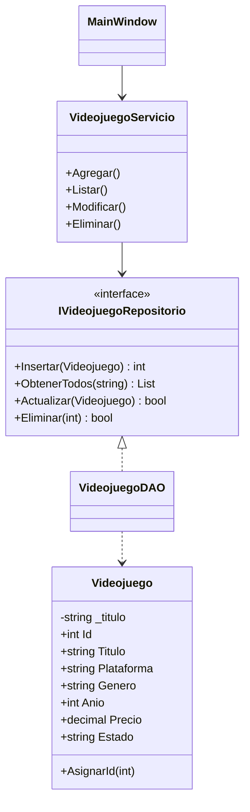
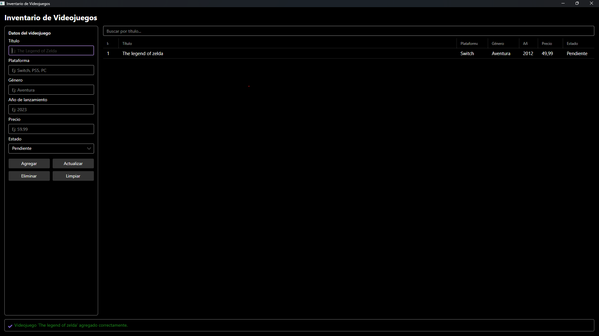
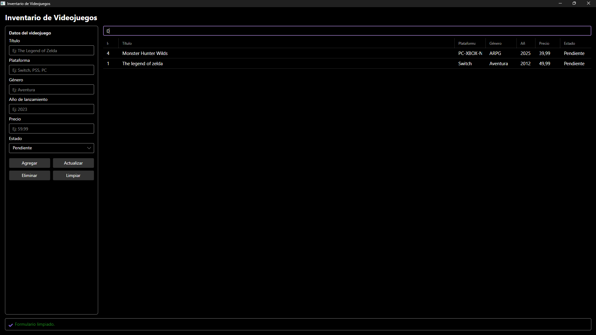
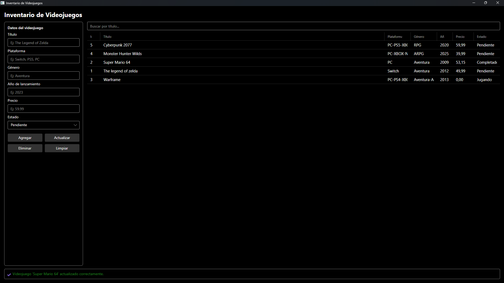
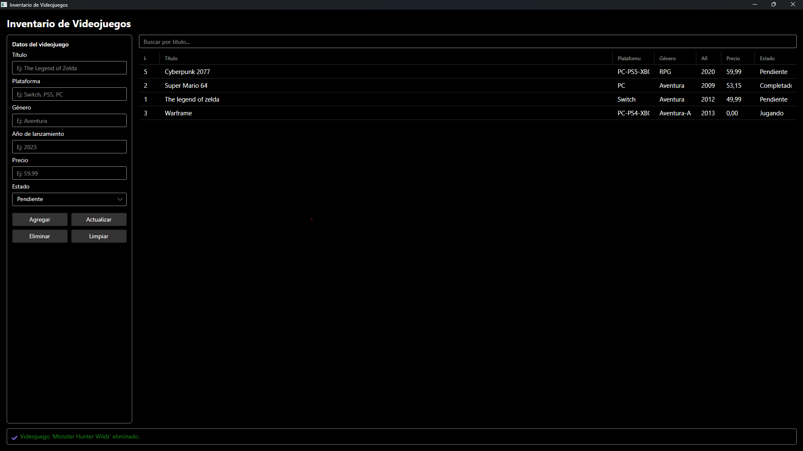
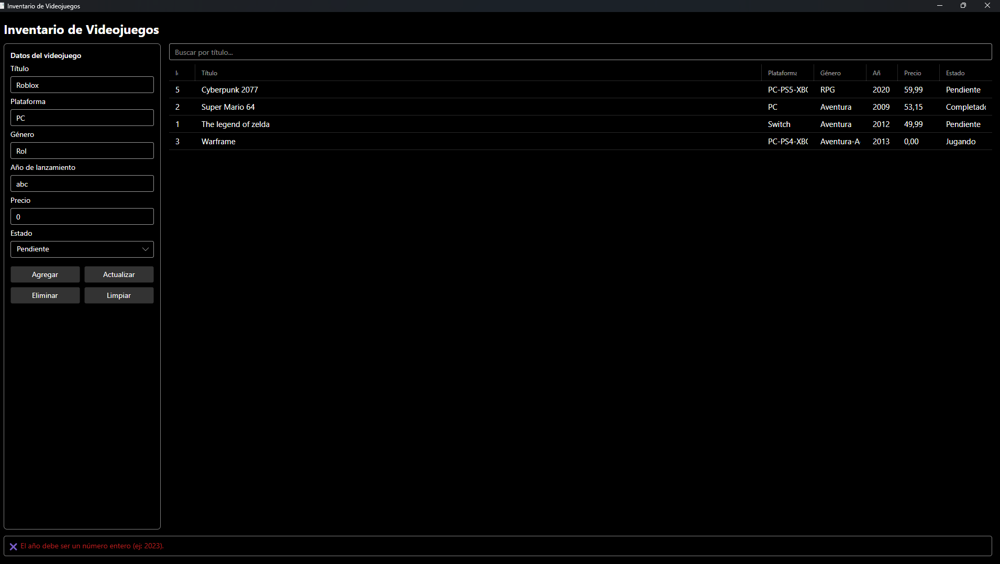

# 🎮 Inventario de Videojuegos

## 1. Información general

- **Proyecto:** Inventario de Videojuegos
- **Estudiante:** _[TU NOMBRE COMPLETO]_
- **Asignatura:** Programación con C# y .NET — Parcial Final
- **Descripción:** Aplicación de escritorio para registrar y administrar una colección personal de videojuegos.
- **Problema que resuelve:** Llevar el control de los juegos que se poseen (plataforma, género, precio y estado de avance) suele hacerse de memoria o en notas dispersas. La aplicación centraliza esa información y la conserva en una base de datos.
- **Objetivo principal:** Demostrar la integración de POO, Avalonia UI y ADO.NET/SQLite mediante un CRUD completo con persistencia.

## 2. Funcionalidades

- **Agregar** un videojuego (título, plataforma, género, año, precio, estado).
- **Consultar** todos los videojuegos en una tabla y **buscar** por título en tiempo real.
- **Modificar** un videojuego: se selecciona en la tabla, se editan los campos y se pulsa *Actualizar*.
- **Eliminar** un videojuego, con ventana de confirmación.
- **Validaciones** con mensajes claros (campos vacíos, año fuera de rango, precio negativo o no numérico, etc.).
- **Mensajes** de éxito (verde) o error (rojo) en la barra inferior.
- **Persistencia:** los datos se conservan al cerrar y volver a abrir.

## 3. Tecnologías utilizadas

| Tecnología | Detalle |
|---|---|
| .NET | 8.0 (`net8.0`) |
| Lenguaje | C# |
| Interfaz gráfica | Avalonia UI 11.2.5 (XAML `.axaml`) |
| Acceso a datos | ADO.NET con `Microsoft.Data.Sqlite` 8.0.11 |
| Base de datos | SQLite |
| Paquetes adicionales | `Avalonia.Desktop`, `Avalonia.Themes.Fluent`, `Avalonia.Controls.DataGrid` |

## 4. Estructura del proyecto

```
InventarioVideojuegos/
├── InventarioVideojuegos.csproj
├── Program.cs                      # Punto de entrada
├── App.axaml / App.axaml.cs        # Configuración de Avalonia y ventana principal
├── Models/
│   └── Videojuego.cs               # Entidad (datos + encapsulamiento)
├── Data/
│   ├── BaseDatos.cs                # Ruta del .db y creación de la tabla
│   ├── IVideojuegoRepositorio.cs   # Interfaz de acceso a datos
│   └── VideojuegoDAO.cs            # CRUD con ADO.NET
├── Services/
│   ├── VideojuegoServicio.cs       # Validaciones y reglas del programa
│   └── ValidacionException.cs      # Excepción de validación
├── Views/
│   ├── MainWindow.axaml            # Interfaz (XAML)
│   └── MainWindow.axaml.cs         # Eventos de la interfaz
├── Database/
│   └── schema.sql                  # Esquema SQL de referencia
└── evidencias/                     # Capturas de las pruebas
```

### Clases principales y responsabilidades

| Clase | Responsabilidad |
|---|---|
| `Videojuego` | Representa un videojuego: propiedades, constructores y métodos. |
| `BaseDatos` | Define dónde está el archivo SQLite y lo inicializa. |
| `IVideojuegoRepositorio` | Contrato de las operaciones de datos. |
| `VideojuegoDAO` | Implementa el contrato ejecutando SQL parametrizado con ADO.NET. |
| `VideojuegoServicio` | Valida los datos y llama al repositorio. |
| `MainWindow` | Captura datos, responde a eventos y muestra resultados. |

**Flujo:** `MainWindow` → `VideojuegoServicio` → `IVideojuegoRepositorio` (`VideojuegoDAO`) → SQLite.



### Dónde se aplican los conceptos de POO

- **Clases y objetos:** `Videojuego`, `VideojuegoDAO`, `VideojuegoServicio`, `MainWindow`.
- **Propiedades y constructores:** `Videojuego` tiene dos constructores (nuevo y leído desde la BD).
- **Encapsulamiento:** campos privados con propiedades que limpian los textos (`Trim`); `Id` solo se modifica internamente (`private set`).
- **Separación de responsabilidades:** interfaz, lógica y datos están en capas distintas.
- **Interfaces / abstracción:** `IVideojuegoRepositorio` evita que el servicio dependa de SQLite directamente; se podría cambiar el almacenamiento sin tocar la lógica.
- **Polimorfismo:** `VideojuegoDAO` se usa a través de la interfaz.
- **Excepciones propias:** `ValidacionException` separa los errores del usuario de los errores técnicos.

## 5. Instalación de dependencias

1. Instalar el **SDK de .NET 8.0**: <https://dotnet.microsoft.com/download/dotnet/8.0>. Verificar con `dotnet --version`.
2. Instalar **Git**: <https://git-scm.com/>.
3. Clonar el repositorio:
   ```bash
   git clone https://github.com/_[TU-USUARIO]_/_[NOMBRE-DEL-REPOSITORIO]_.git
   cd _[NOMBRE-DEL-REPOSITORIO]_
   ```
4. Restaurar las dependencias (descarga Avalonia y Microsoft.Data.Sqlite):
   ```bash
   dotnet restore
   ```

No se necesita ninguna configuración adicional ni instalar SQLite por separado.

## 6. Ejecución del programa

Desde la carpeta que contiene `InventarioVideojuegos.csproj`:

```bash
dotnet restore
dotnet run
```

> Si el `.csproj` quedó dentro de una subcarpeta del repositorio, primero entra a ella con `cd`.

## 7. Base de datos

- **Qué almacena:** los videojuegos de la colección.
- **Tabla `Videojuegos`:**

| Campo | Tipo | Descripción |
|---|---|---|
| `Id` | INTEGER PK AUTOINCREMENT | Identificador único |
| `Titulo` | TEXT NOT NULL | Nombre del juego |
| `Plataforma` | TEXT NOT NULL | Consola o PC |
| `Genero` | TEXT NOT NULL | Género |
| `Anio` | INTEGER NOT NULL | Año de lanzamiento |
| `Precio` | REAL NOT NULL | Precio |
| `Estado` | TEXT NOT NULL | Pendiente / Jugando / Completado / Abandonado |

- **Conexión:** `BaseDatos.CadenaConexion` construye `Data Source=<ruta>/inventario.db`; cada operación abre un `SqliteConnection` dentro de un bloque `using`.
- **CRUD:** todas las operaciones están en `Data/VideojuegoDAO.cs` (`Insertar`, `ObtenerTodos`, `Actualizar`, `Eliminar`) con comandos SQL parametrizados.
- **Inicialización:** **automática**. Al abrir la aplicación, `BaseDatos.Inicializar()` crea la carpeta, el archivo y la tabla si no existen. No hay que ejecutar nada manualmente (`Database/schema.sql` es solo referencia).
- **Ubicación del archivo:**
  - Windows: `%LOCALAPPDATA%\InventarioVideojuegos\inventario.db`
  - Linux: `~/.local/share/InventarioVideojuegos/inventario.db`
  - macOS: `~/Library/Application Support/InventarioVideojuegos/inventario.db` (puede variar)

## 8. Evidencias de funcionamiento

> Reemplaza cada imagen por tu captura real, guardada en la carpeta `evidencias/`.

| # | Prueba | Acción | Resultado esperado | Evidencia |
|---|---|---|---|---|
| 1 | Registro | Agregar un videojuego | Se guarda y aparece en la tabla |  |
| 2 | Consulta | Visualizar la lista y buscar por título | Se muestran los registros almacenados |  |
| 3 | Actualización | Seleccionar, modificar y pulsar *Actualizar* | Los cambios se guardan |  |
| 4 | Eliminación | Seleccionar y eliminar (confirmando) | El registro deja de aparecer |  |
| 5 | Validación | Dejar el título vacío o escribir un año inválido | Mensaje de error y el programa sigue abierto |  |
| 6 | Persistencia | Cerrar y volver a abrir | Los registros siguen disponibles |  |

_Debajo de cada imagen escribe 1–2 líneas explicando qué probaste y qué resultado obtuviste._

## 9. Problemas encontrados y soluciones

> **Escribe aquí una dificultad REAL que hayas tenido.** Ejemplo de formato:
>
> **Problema:** _[describe el error o dificultad, p. ej.: la tabla no mostraba datos / error al restaurar paquetes / el formulario se limpiaba al seleccionar una fila]_
>
> **Solución:** _[explica qué hiciste para resolverlo y qué aprendiste]_
